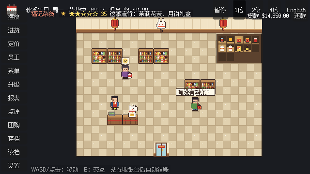

# Chinese Grocery · 华人超市

一款 2D 俯视角像素风模拟经营游戏。你是刚大学毕业的华人二代，接手父母经营了 20 年的街角杂货店，从进货、上架、收银做起，一步步把它做成大型华人超市。故事设在美国城市。

*A 2D top-down pixel-art management sim: a second-generation Chinese American takes over the family corner store and grows it into a big Asian supermarket.*



## 现在能玩到什么

里程碑 M1–M15 已完成（详见 [`spec.md`](spec.md) 第 8 节路线图）：

- **经营循环**：进货、上架、定价、收银，格子上自由摆放设施，累计营收达标后升级店面
- **五个部门**：干货与零食、肉类（整块拆部位、边角料绞馅）、海鲜（鱼池、冰台）、果蔬（新鲜度、整齐度）、熟食（用临期食材做菜）
- **员工**：招聘、排班、士气、经验升级、店长自动管理部门
- **日历与节日**：四季、春节 / 端午 / 中秋 / 感恩节 / 圣诞，节日备货与装饰，随机事件（卫生检查、停电、断货……）
- **口碑**：星级、点评、流行商品、更多顾客类型、餐馆团购
- **进口海运**：便宜但要提前订，托盘到货要卸货
- **剧情与新手引导**：父母的电话、主线章节、学生贷款
- 中英双语，所有文字都走翻译表

美术目前是过渡素材，数值多为占位值（数据文件里标着 `"_tbd": true`）。

## 运行

需要：

- [Godot 4.7（.NET 版）](https://godotengine.org/download)
- [.NET 10 SDK](https://dotnet.microsoft.com/download)

用 Godot 打开 `game/` 文件夹，按 F5 运行。或者在命令行里（`$GODOT` 是 Godot .NET 可执行文件的路径）：

```bash
$GODOT --path game
```

操作：WASD 或鼠标点击移动，E / 空格交互，站到收银台后面自动结账。左边一列按钮打开各个管理面板。

## 开发

```bash
dotnet build                                                 # 构建全部
dotnet test                                                  # 跑全部测试
dotnet run --project tools/SimRunner -- --days 30 --seed 1   # 无画面跑 30 天模拟，输出每日报表
$GODOT --headless --path game --build-solutions --quit       # 检查 Godot 项目能否构建
```

游戏规则全部写在纯 C# 类库 `src/Sim` 里，不依赖 Godot，是确定性的：同一个种子加同样的操作，结果完全一样。所以大部分功能可以用测试和 SimRunner 验证，不用开游戏。

SimRunner 常用参数：`--days N`、`--seed S`、`--auto`（店长自动管理）、`--imports`（尽量走海运进口）、`--good-service` / `--poor-service`（口碑对照）、`--no-festival-stock`（节日不备货对照）。全部参数见 `tools/SimRunner/Program.cs` 开头的用法说明。

### 目录

```
src/Sim             游戏规则和状态（纯 C#，不引用 Godot）
tests/Sim.Tests     xUnit 测试
tools/SimRunner     命令行：无画面跑模拟并输出报表
tools/art, audio    生成过渡美术和音效的脚本
game/               Godot 项目：画面、输入、界面
game/locale         翻译表 strings.csv（key, en, zh）
data/               数据表（商品、设施、顾客、员工、节日、事件……）
docs/screenshots    每个里程碑的游戏截图
docs/notes          实现时定下的默认规则和数值，等设计确认
spec.md             技术规格，需求以它为准
CLAUDE.md           写代码的规则（架构、确定性、钱用整数美分等）
```

### 截图

每个里程碑都有一段脚本化的截图流程，会把截图存进 `docs/screenshots/`：

```bash
$GODOT --path game --write-movie /tmp/x.png --fixed-fps 30 -- --screenshot-tour=$PWD/docs/screenshots/M12 --tour=m12
```

可选的 `--tour=` 有 `m8` 到 `m15` 和 `fixes`。

## 字体

界面字体是 [Fusion Pixel](https://github.com/TakWolf/fusion-pixel-font)，按 SIL Open Font License 使用，许可证在 `game/fonts/fusion-pixel/`。
